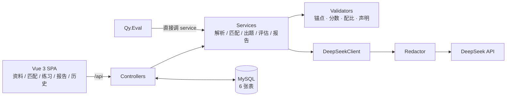

# Interview Coach

简历 × JD 驱动的 LLM 模拟面试练习工具：结构化抽取、加权匹配、带证据锚点的出题、逐题评估与策略追问、报告与跨场次统计。

## 功能

- 简历 / JD 录入：粘贴文本、PDF 抽文字层、图片 OCR，后端只收纯文本。
- 匹配分析：三态对齐表（strong / partial / missing）、加权匹配分、硬性阻断提示。
- 模拟练习：8 道题（`resume / gap / general`），每题标注来源与证据锚点；逐题评分、声明核验、最多一次追问。
- 报告与统计：四维均分、topRisks、最该补的证据、25 个弱点标签的跨场次聚合。
- 历史记录：未完成可续答，资料删除支持级联清理。

## 技术栈

| 层 | 选型 |
|---|---|
| 后端 | .NET 10 / ASP.NET Core Web API |
| ORM | EF Core 9 + Pomelo 9（EF Core 10 暂无 MySQL provider） |
| 数据库 | MySQL 8.0.46 / utf8mb4 |
| 模型 | DeepSeek `deepseek-chat`，JSON 模式，temperature 0.2 |
| 前端 | Vue 3 + TypeScript + Vite + naive-ui |
| 测试 | xunit v3 in-proc runner，151 个用例 |

## 架构



- 控制器只做请求解析、状态码与落库顺序，业务规则在 service。
- 校验器、出题配比、追问策略、报告聚合均为纯函数，可脱离数据库与网络单测。
- 6 张表：`resumes` / `job_targets` / `matches` / `sessions` / `questions` / `question_scores`；锚点与评估以 JSON 挂在题目行，四维分拆行以支持 `GROUP BY`。

## AI 工作流

```
解析(profile + anchors) → 加权匹配 → 出题(8) → 评估(四维 + claimChecks) → 策略追问 → 报告
```

1. **解析**：简历 / JD 各生成 `profile` 与锚点（`r:proj:2`、`j:req:3`），锚点 ID 由代码分配，模型只能引用。
2. **匹配**：总分固定为 `mustHave 45 + responsibilities 25 + evidenceQuality 20 + bonus 10`；校验四项和等于总分（±1）、JD 锚点全覆盖、`category` 与锚点类型匹配、非 missing 必须有简历证据。
3. **出题**：默认 `resume 3 / gap 3 / general 2`；`gap` 题只能引用「match 判 missing 且原文命中」的 JD 锚点。
4. **评估**：6 项原子分供策略表、4 项展示分供报告；`claimChecks` 四态，`supported` / `contradicted` 必须有简历锚点。
5. **追问**：代码按「事实错误 / 声明矛盾 / 无量化 / 缺口题」决定动作，模型只写措辞，深度上限 1。
6. **报告**：四维均分换算 0–100，汇总 topRisks 与待补证据；弱点只从固定 25 标签中白名单过滤。

模型调用统一 `json_object`、T=0.2、超时 90s、重试 2 次（指数退避）；结构校验失败带问题清单 repair 一次，仍失败则返回 502，不落可疑数据。匹配结果按输入指纹缓存，`refresh=true` 可绕过。

**评测与脱敏**：`backend/Qy.Eval` 用 10 个合成 case 跑 5 项指标（重复率、锚点合法率、缺口题引用率、隐私命中、repair 率），不达标退出码为 1；脱敏挂在 `DeepSeekClient` 唯一出口，覆盖手机号、邮箱、身份证、姓名。

## 快速开始

前置：.NET SDK 10、MySQL 8.0+、Node.js 20+、DeepSeek API Key。

```bash
# 1. 建库（会先 DROP，仅用于开发库）
mysql -u root -p < db/schema.sql

# 2. 配置 backend/InterviewAssistant.Api/appsettings.Development.json（已 gitignore）
# { "ConnectionStrings": { "InterviewAssistant": "Server=localhost;Port=3306;Database=interview_assistant_dev;User=root;Password=***;" },
#   "DeepSeek": { "BaseUrl": "https://api.deepseek.com", "Model": "deepseek-chat", "ApiKey": "sk-..." } }

# 3. 后端 http://localhost:5052，Swagger /swagger
dotnet run --project backend/InterviewAssistant.Api --launch-profile http

# 4. 前端 http://localhost:5173
cd frontend && npm install && npm run dev
```

`ApiKey` 也可用环境变量 `DEEPSEEK_API_KEY`。

## 测试

```bash
pwsh scripts/test.ps1                                    # 151 个用例
dotnet build --no-incremental -warnaserror               # 要求 0 warning
dotnet format --verify-no-changes
cd frontend && npm run build                             # vue-tsc + Vite

$env:DEEPSEEK_API_KEY = "sk-..."
dotnet run --project backend/Qy.Eval -- --cases 10 --answers 2   # 生成 evals/report.json
```

.NET 10 上 `dotnet test` 的 VSTest 入口不可用，测试统一走 `scripts/test.ps1`。

## 项目结构

```
backend/
  InterviewAssistant.Api/     Web API：Controllers、Services、Prompts、Data、Models
  InterviewAssistant.Tests/   xunit 用例
  Qy.Eval/                    离线评测控制台
frontend/                     Vue 3 前端
db/schema.sql                 MySQL 建表脚本
evals/report.json             最近一次评测结果
docs/                         规格、决策、进度、后端详解
scripts/test.ps1              测试入口
```

## 已知限制

- 无鉴权、单用户（`user_id` 固定 `local`），定位是本地练习工具。
- 每题只保留最后一轮评分，追问会覆盖初答四维分。
- 匹配缓存无 TTL，只按输入指纹失效；弱点统计含未完成场次。
- 姓名脱敏是正则而非 NER，正文裸写姓名会漏。
- 无集成测试宿主，控制器异常分支仅手工验证；「删除全部数据」接口未实现。

完整取舍见 [docs/progress.md](docs/progress.md)。

## 文档

- [docs/spec-v3.md](docs/spec-v3.md)：规格、接口、模型契约与验收标准
- [docs/backend-deep-dive.md](docs/backend-deep-dive.md)：后端流程与核心机制
- [docs/decisions-project-selection.md](docs/decisions-project-selection.md)：范围与参数决策
- [docs/progress.md](docs/progress.md)：切片进度、验收证据、已知取舍
- [frontend/README.md](frontend/README.md)：前端运行方式与代码约定
