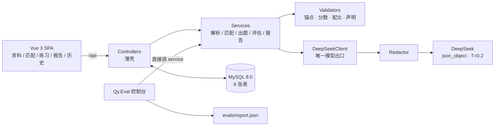

# Interview Coach

简历 × JD 驱动的 LLM 模拟面试练习工具：上传简历与目标岗位 JD，系统做结构化抽取与加权匹配，围绕简历证据和 JD 缺口生成带证据锚点的面试题，对作答做评估与策略化追问，最终产出面试报告与跨场次弱点统计，并配有离线评测与请求侧脱敏。

**本地单用户模拟练习工具，不接入真实面试流程**——定位类似"面试备考的 LeetCode 模拟赛"，而非面试辅助工具。

## 功能总览

| 页面 | 功能 |
|---|---|
| 资料管理 | 简历 / JD 上传（PDF、图片 OCR、文本），解析为结构化数据并生成证据锚点 |
| 匹配分析 | 简历 × JD 加权匹配（mustHave / 职责 / 证据质量 / 加分项），给出差距缺口 |
| 模拟练习 | 按配比出题（简历题 / 缺口题 / 通用题），作答后评估打分、声明核验、策略化追问 |
| 面试报告 | 四维加权评分、claimChecks 声明核验结果、逐题复盘 |
| 历史统计 | 25 个固定弱点标签跨场次聚合，定位长期短板 |

## 架构



- 6 张表：`resumes` / `job_targets` / `matches` / `sessions` / `questions` / `question_scores`。
- 锚点、评估、声明核验以 JSON 挂在题目行；四维分拆行，支持 `GROUP BY dimension`。
- 一致原则：**模型只负责判断和措辞，能否使用由服务端校验**；校验不过 repair 一次，仍不过则抛错、不落库。

## 核心链路走读

按数据流顺序阅读，每步只看核心文件：

1. **解析**：`Controllers/ResumesController.cs` → `Services/ResumeParser.cs` / `Services/JdParser.cs`。模型抽取结构化信息；`Models/Anchor.cs` 定义证据锚点（`r:proj:2` / `j:req:3` 等 ID + 原文 quote），代码分配锚点 ID，模型只能引用不能编造。
2. **加权匹配**：`Services/Match/MatchService.cs` + `MatchValidator.cs` + `MatchStore.cs`。总分固定为 `mustHave 45 + responsibilities 25 + evidenceQuality 20 + bonus 10`；校验四项和 = 总分（±1）、JD 锚点全覆盖、非 missing 必须有简历证据。`InputFingerprint.cs` 按 `input_hash` 缓存匹配结果，`refresh=true` 绕过。
3. **出题**：`Services/Questions/QuestionPlanner.cs`（配比：默认 `resume 3 / gap 3 / general 2`，缺口不足时向简历题倾斜）→ `QuestionGenerator.cs` → `QuestionValidator.cs`（配比与锚点引用校验）。
4. **作答评估与追问**：`Services/Interview/InterviewService.cs` → `AssessmentJson.cs` / `AssessmentValidator.cs`（原子分 6 项、claimChecks 四态，`supported`/`contradicted` 必须有简历锚点）→ `StrategyEngine.cs`（代码按「事实错误 / 声明矛盾 / 无量化 / 缺口题」决定追问动作，模型只写措辞，深度上限 1）→ `WeaknessCatalog.cs`（固定 25 个弱点标签，服务端白名单过滤）。
5. **报告与统计**：`Services/Report/ReportBuilder.cs`（原子分 → 展示分 4 项加权聚合）→ `Stats/WeaknessStatsBuilder.cs`（跨场次弱点聚合、四维均分）。
6. **模型出口与脱敏**：所有 6 类 LLM 调用收敛到 `Services/Llm/DeepSeekClient.cs`（`json_object`、T=0.2、超时 90s、重试 2 次指数退避、repair 1 次），出口前置 `Services/Llm/Redactor.cs` 做脱敏。看懂这两个文件就看懂了全部模型交互。

配套设计文档：[`docs/spec-v3.md`](docs/spec-v3.md)（先读这个）、[`docs/backend-deep-dive.md`](docs/backend-deep-dive.md)（机制细节）。

## AI 工程化

- **模型契约**：6 类调用（简历解析 / JD 解析 / 匹配 / 出题 / 评估 / 追问措辞），全部 `json_object`、T=0.2、max_tokens 4096；API 超时 90s，重试 2 次指数退避；结构校验失败 repair 1 次；失败终态为 502，不落可疑数据。
- **证据锚点**：代码分配 `r:proj:2` / `j:req:3` 等 ID，模型只能引用。锚点含原文 `quote`（≤200 字 / 4 行）与 `quoteExact`；校验引用合法、简历题须有 `r:` 锚点、缺口题须对应 `missing` 且原文命中的 `j:` 锚点。
- **加权匹配**：校验四项和 = 总分（±1）、JD 锚点全覆盖、`category` 与锚点类型匹配、非 missing 必须有简历证据、`mustHave+missing` 必须 `hardBlock=true`。
- **追问策略**：代码决定动作（prerequisite / verification / metrics / boundary），模型只写措辞，深度上限 1。
- **评分**：原子分 6 项供策略表，展示分 4 项供报告；`claimChecks` 四态，JD 锚点不能当证据；prompt 禁止按字数、关键词打分。
- **弱点标签**：固定 25 个，模型选 1–4 个，服务端白名单过滤，保证跨场次可聚合。
- **缓存与成本**：匹配按 `input_hash` 缓存，`refresh=true` 可绕过；客户端取消后不再重试；关闭 EventLog provider 避免日志写入失败杀进程。

## 离线评测

`backend/Qy.Eval` 独立控制台项目，不依赖数据库，直接调用 service；指标不达标时退出码为 1。

- 10 个合成 case，覆盖 junior / mid / senior × knowledge / project；每 case = 简历 + JD + 两段预置回答；其中 2 个 case 埋入手机号、邮箱、姓名验证脱敏。
- 默认每 case 评估 2 道题（80 题评 20 题），`--answers 8` 全覆盖。

| 指标 | 阈值 | 当前值 |
|---|---|---|
| `duplicateQuestionRate`（字二元组 Jaccard ≥ 0.75 判重，取各场平均） | ≤ 0.2 | 0 |
| `evidenceValidityRate`（引用锚点合法率） | ≥ 0.9 | 1.0 |
| `gapCitationRate`（缺口题命中原文锚点比例） | = 1.0 | 1.0（10 道） |
| `privacyMarkerHits` | = 0 | 0 |
| `jsonRepairRate` | ≤ 0.3 | 0 |

首轮评测失败 5/10，暴露两个 prompt 缺陷（bonus 分类挂错锚点、JD 锚点被当作声明证据），均已修复。

局限：`evidenceValidityRate` / `gapCitationRate` 统计校验后的结果，成功 case 恒为 1，只能当回归冒烟；对退化更敏感的是 `duplicateQuestionRate` 与 `jsonRepairRate`。

## 脱敏

脱敏挂在模型调用唯一出口 `DeepSeekClient`，6 个调用点自动覆盖：

| 类型 | 规则 | 占位符 |
|---|---|---|
| 手机号 | 11 位、空格/短横分隔、`+86` 前缀 | `【手机号】` |
| 邮箱 | 标准格式 | `【邮箱】` |
| 身份证 | 18 位且第 7–14 位为合法生日 | `【身份证】` |
| 姓名 | `姓名：`、行首 `名字/Name:`、`我叫…`、`张三，男` 首行格式 | `【姓名】` |

占位符不含原值；`Project Name:` / `Company Name:` 刻意不替换，避免误伤项目名与公司名；简历 / JD 原文只存本地 MySQL，不写日志；评测埋标记断言输出为 0 命中。姓名脱敏是正则而非 NER，正文裸写姓名会漏（已知取舍）。

## 技术栈

| 层 | 选型 |
|---|---|
| 后端 | .NET 10 / ASP.NET Core Web API |
| ORM | EF Core 9 + Pomelo 9（EF Core 10 暂无 MySQL provider） |
| 数据库 | MySQL 8.0.46 / utf8mb4 |
| 模型 | DeepSeek `deepseek-chat`，JSON 模式 |
| 前端 | Vue 3 + TypeScript + Vite + naive-ui；PDF / OCR 按需加载 |
| 测试 | xunit v3 in-proc runner，151 个用例 |

## 本地运行

```bash
mysql -u root -p < db/schema.sql
# backend/InterviewAssistant.Api/appsettings.Development.json（已 gitignore）
# { "ConnectionStrings": { "InterviewAssistant": "..." },
#   "DeepSeek": { "BaseUrl": "...", "Model": "deepseek-chat", "ApiKey": "..." } }
dotnet run --project backend/InterviewAssistant.Api --launch-profile http   # :5052，/swagger
cd frontend && npm install && npm run dev                                  # :5173
pwsh scripts/test.ps1                                                      # 151 用例
$env:DEEPSEEK_API_KEY="sk-..."; dotnet run --project backend/Qy.Eval -- --cases 10 --answers 2
```

`ApiKey` 也可用环境变量 `DEEPSEEK_API_KEY`。测试统一走 `scripts/test.ps1`（.NET 10 的 VSTest 入口不可用）。

## 质量与取舍

- 测试 151 用例全绿；`dotnet build --warnaserror` 0 warning；`dotnet format --verify-no-changes` 通过；前端 `vue-tsc` + Vite 构建通过。
- 已知取舍：无集成测试宿主（控制器分支仅手工验证）；每题只保留最后一轮评分；匹配缓存无 TTL；弱点统计含未完成场次；无鉴权、单用户；「删除全部数据」未实现；前端无自动化测试；评测为抽样。完整清单见 [`docs/progress.md`](docs/progress.md)。

## 文档

[`docs/spec-v3.md`](docs/spec-v3.md)（规格与验收）、[`docs/backend-deep-dive.md`](docs/backend-deep-dive.md)（后端机制）、[`docs/decisions-project-selection.md`](docs/decisions-project-selection.md)（决策记录）、[`docs/progress.md`](docs/progress.md)（进度与取舍）、[`docs/vibe-log.md`](docs/vibe-log.md)（开发过程）、[`frontend/README.md`](frontend/README.md)（前端约定）。
